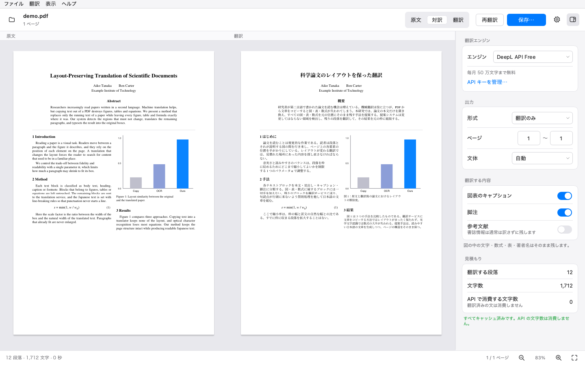
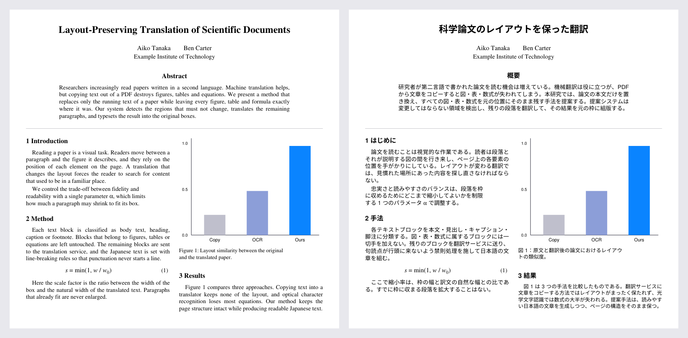

<p align="center">
  
</p>

<h1 align="center">Spectra</h1>

<p align="center">
  論文の PDF を、図表・数式・レイアウトを崩さずに日本語へ翻訳するデスクトップアプリ
</p>

<p align="center">
  <a href="https://github.com/myuto2490/Spectra/releases/latest"></a>
  <a href="https://github.com/myuto2490/Spectra/actions/workflows/ci.yml"></a>
  <a href="LICENSE"></a>
  
</p>

<p align="center">
  
</p>

## 特長

- **PDF のまま翻訳** — 翻訳結果も元と同じページ構成の PDF。ページ番号も図の位置もそのままです。
- **図表・数式を壊さない** — 画像・グラフ・表の罫線・独立した数式・図の中の文字には一切手を加えません。翻訳後に自動検査を行い、図表の見た目が 1 ピクセルも変わっていないことを確認します。
- **段落中の数式もそのまま** — 本文中の数式（例: 学習率 α、下付きの d<sub>k</sub>）は翻訳から保護し、訳文の中の自然な位置に元の形のまま配置します。
- **読みやすい日本語の組版** — 禁則処理、和文と欧文の間の適切な空き、両端揃え、字下げに対応。2 段組で段をまたぐ段落も、原文と同じように流し込みます。明朝体（Noto Serif JP）も選べます。
- **無料の翻訳 API で使える** — DeepL API Free と Google Cloud Translation に対応（どちらも毎月 50 万文字まで無料）。翻訳済みの文はキャッシュされるので、同じ論文を訳し直しても文字数を消費しません。
- **API キーは安全に保管** — macOS キーチェーン / Windows 資格情報マネージャー / Linux のキーリングに保存します。
- **出力形式を選べる** — 翻訳のみ / 原文と訳文を左右に並べた対訳 / ページごとに交互の対訳。

<p align="center">
  
  <br>
  <sub>左：原文　右：Spectra で翻訳した PDF（図・数式・著者名はそのまま、本文だけが日本語に）</sub>
</p>

## ダウンロード

[Releases](https://github.com/myuto2490/Spectra/releases/latest) から、お使いの OS のファイルをダウンロードしてください。

| OS | ファイル | 使い方 |
| --- | --- | --- |
| macOS（Apple シリコン） | `Spectra-x.y.z-macOS-arm64.dmg` | 開いて `Spectra` を「アプリケーション」へドラッグ |
| macOS（Intel） | `Spectra-x.y.z-macOS-x86_64.dmg` | 同上 |
| Windows 10 / 11 | `Spectra-x.y.z-Windows-x64.zip` | 展開して `Spectra.exe` を実行 |
| Linux（x86_64） | `Spectra-x.y.z-Linux-x86_64.tar.gz` | 展開して `Spectra/Spectra` を実行 |

> [!NOTE]
> 署名の準備が整うまでの間、配布版は未署名の場合があります（設定方法は [docs/CODE_SIGNING.md](docs/CODE_SIGNING.md)）。初回起動時に警告が表示された場合は次のように開いてください。
>
> - **macOS**: アプリを右クリック（Control + クリック）→「開く」→「開く」
> - **Windows**: 「Windows によって PC が保護されました」→「詳細情報」→「実行」

## 使い方

1. **API キーを設定する** — 初回は ⚙（設定）→「翻訳エンジン」で API キーを貼り付け、「接続を確認」を押します（取得方法は[下記](#api-キーの取得)）。
2. **PDF を開く** — ウィンドウに PDF をドラッグ＆ドロップするか、「PDF を選択…」を押します。右側のインスペクタに、翻訳する文字数の見積もりと今月の残り文字数が表示されます。
3. **翻訳して保存** — 「翻訳」を押すと、原文と訳文が並んで表示されます。確認したら「保存…」で PDF を書き出します。

インスペクタでは、出力形式・翻訳するページの範囲・キャプションや脚注を訳すかどうか・文体（である調 / です・ます調、DeepL のみ）を変えられます。

### キーボードショートカット

| 操作 | macOS | Windows / Linux |
| --- | --- | --- |
| PDF を開く | ⌘O | Ctrl+O |
| 翻訳を開始 | ⌘↩ | Ctrl+Enter |
| 保存 | ⌘S | Ctrl+S |
| 原文 / 対訳 / 翻訳 の表示 | ⌘1 / ⌘2 / ⌘3 | Ctrl+1 / 2 / 3 |
| 拡大 / 縮小 / 幅に合わせる | ⌘+ / ⌘− / ⌘0 | Ctrl++ / Ctrl+− / Ctrl+0 |
| 設定 | ⌘, | Ctrl+, |
| 翻訳をキャンセル | Esc | Esc |

## API キーの取得

### DeepL API Free（おすすめ）

1. [DeepL API のページ](https://www.deepl.com/pro-api) で「無料で登録する」から **DeepL API Free** に登録します（本人確認のためクレジットカードの登録が必要ですが、Free プランで課金されることはありません）。
2. [アカウント → API キー](https://www.deepl.com/your-account/keys) で認証キーをコピーします。Free プランのキーは末尾が `:fx` です。
3. Spectra の設定画面に貼り付けます。

### Google Cloud Translation

1. [Google Cloud Console](https://console.cloud.google.com/) でプロジェクトを作成し、請求先アカウントを設定します（毎月 50 万文字までは無料枠の範囲です）。
2. [Cloud Translation API](https://console.cloud.google.com/apis/library/translate.googleapis.com) を「有効にする」。
3. 「API とサービス」→「認証情報」→「認証情報を作成」→「API キー」でキーを作成します。安全のため、キーの「API の制限」で Cloud Translation API のみに制限することをおすすめします。

> [!TIP]
> 翻訳前にインスペクタの「見積もり」で消費する文字数を確認できます。今月の残りを超える場合は警告が表示されます。途中で無料枠を使い切った場合も、翻訳できた段落だけで PDF を作成でき、残りは翌月にキャッシュの続きから翻訳できます。

## 仕組み

Spectra は PDF を作り直すのではなく、**元の PDF の本文の文字だけを訳文に置き換えます**。

1. **解析** — 文字ごとのフォント・大きさ・位置を読み取り、本文・見出し・キャプション・脚注を判別します。図（画像やまとまったベクター図形）・表・数式・著者名・参考文献・回転した文字は「翻訳しない領域」として除外します。迷ったときは訳さないのが基本方針です。
2. **数式の保護** — 段落中の数式や引用番号 `[12]` はタグに置き換えて翻訳 API に送り、訳文の中で元の書体・上付き/下付きの位置関係のまま組み直します。根号や分数の線も一緒に移動します。
3. **翻訳** — キャッシュにない文だけを、選んだ翻訳 API にまとめて送ります。
4. **組版** — 日本語の組版規則に従って、訳文を元の段落の枠に流し込みます。収まらない場合は文字を少しずつ小さくし、枠からはみ出すことはありません。
5. **置き換え** — 原文の文字だけを消し（画像・図形・背景はそのまま）、訳文を書き込みます。フォントは使った文字だけを埋め込むので、ファイルサイズはほとんど増えません。
6. **検査** — 翻訳前後を比較し、画像と図形の数、翻訳対象外の文字、図表の見た目（画素）が変わっていないことを自動で確かめます。

設計の詳細は [docs/DESIGN.md](docs/DESIGN.md) を参照してください。

## よくある質問

<details>
<summary>スキャンした論文（画像だけの PDF）も翻訳できますか？</summary>

できません。文字を選択・コピーできる PDF が対象です。スキャン PDF は、先に OCR ソフトで文字情報を付けてから開いてください。
</details>

<details>
<summary>論文の内容はどこかに送信されますか？</summary>

翻訳する本文が、選んだ翻訳サービス（DeepL または Google）にのみ送信されます。Spectra 自体は利用状況などのデータを一切送信しません。DeepL API Free では送信したテキストが翻訳品質の改善に使われる場合があるため、未公開の原稿など機密性の高い文書には有料プランの利用を検討してください。
</details>

<details>
<summary>訳文の文字が小さくなっている段落があります</summary>

訳文が元の枠に収まらない場合、レイアウトを守るために自動で文字を小さくしています。設定 →「フォント」→「文字の大きさ」で基準の大きさを調整できます。
</details>

<details>
<summary>参考文献や表の中身は翻訳されないのですか？</summary>

書誌情報や表の数値は訳さない方が読みやすいため、既定では残しています。参考文献はインスペクタの「参考文献」をオンにすると翻訳されます。
</details>

## コマンドラインでの利用

アプリと同じ処理をコマンドラインからも実行できます（Python 3.10 以上）。

```sh
pip install git+https://github.com/myuto2490/Spectra.git

spectra key set deepl                       # API キーを保存（入力は表示されません）
spectra estimate paper.pdf                  # 翻訳する文字数の見積もり
spectra translate paper.pdf                 # paper_ja.pdf を作成
spectra translate paper.pdf --mode side-by-side --pages 1-8 --font noto-serif
spectra --help
```

環境変数 `DEEPL_AUTH_KEY` / `GOOGLE_API_KEY` が設定されていれば、それを優先して使います。

## 開発

```sh
git clone https://github.com/myuto2490/Spectra.git
cd Spectra
python -m venv .venv && source .venv/bin/activate   # Windows: .venv\Scripts\activate
pip install -e ".[dev]"

python -m spectra          # アプリを起動
pytest                     # テスト（ネットワーク不要）
ruff check src tests       # 静的解析
```

- `SPECTRA_DEV=1` を設定すると、API を使わずに組版だけを確認できる「擬似翻訳」エンジンが選べるようになります。
- ブランチ運用・コミットの書き方・リリース手順は [CONTRIBUTING.md](CONTRIBUTING.md) を参照してください。
- 変更履歴は [CHANGELOG.md](CHANGELOG.md) にあります。

## ライセンス

Spectra は [GNU Affero General Public License v3.0](LICENSE)（AGPL-3.0-or-later）で配布するフリーソフトウェアです。

主な依存ソフトウェア: [PyMuPDF](https://github.com/pymupdf/PyMuPDF)（AGPL-3.0）、[Qt for Python / PySide6](https://www.qt.io/qt-for-python)（LGPL-3.0）、[fontTools](https://github.com/fonttools/fonttools)（MIT）。任意でダウンロードできる Noto Serif JP / Noto Sans JP は SIL Open Font License 1.1 です。

DeepL は DeepL SE の、Google Cloud は Google LLC の商標です。Spectra はこれらの企業とは関係のない個人開発のソフトウェアです。

---

<details>
<summary>English</summary>

**Spectra** is a free, open-source desktop app (Windows, macOS, Linux) that translates academic PDFs from English into Japanese **while keeping the original layout intact**. Figures, tables, equations and author names are left untouched; only the running text, headings, captions and footnotes are replaced with Japanese text typeset into the original boxes. Inline math is protected during translation and re-placed with its original geometry. It works with the free tiers of DeepL API and Google Cloud Translation, caches translations to save quota, and verifies after each run that figures and untranslated text have not changed. Licensed under AGPL-3.0.
</details>
