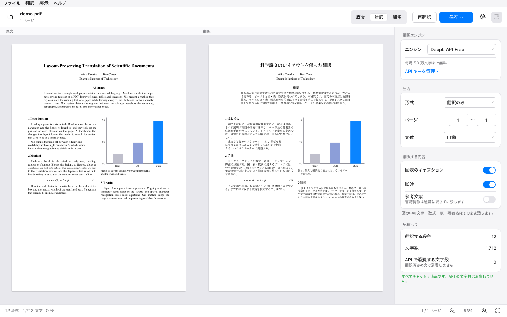
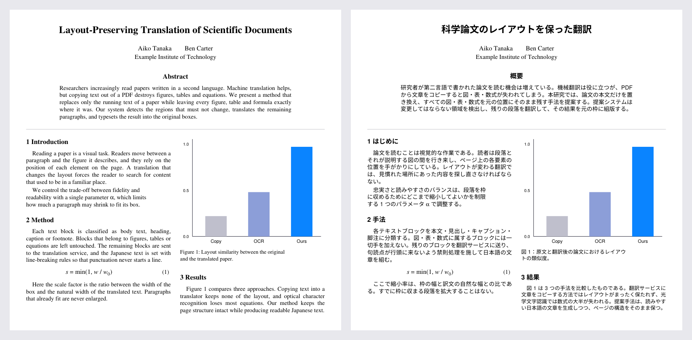
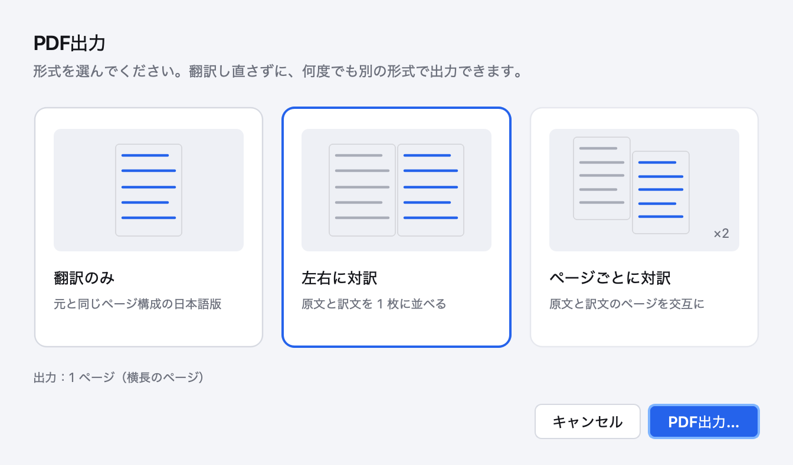

<p align="center">
  
</p>

<h1 align="center">Spectra</h1>

<p align="center">
  論文を、そのままのレイアウトで日本語に。
</p>

<p align="center">
  <a href="https://github.com/myuto2490/Spectra/releases/latest"></a>
  <a href="https://github.com/myuto2490/Spectra/actions/workflows/ci.yml"></a>
  <a href="LICENSE"></a>
  
</p>

<p align="center">
  
</p>

Spectra は、英語の論文 PDF を **PDF のまま** 日本語に翻訳するデスクトップアプリです。
本文・見出し・キャプションだけを日本語に置き換え、図・表・数式・ページ構成は元の論文のまま残します。
読んだ論文はライブラリに集まり、タイトル・著者・雑誌名などの書誌情報で整理して、いつでも原文と訳文を並べて読み返せます。
翻訳には Google の Gemini API を使い、無料枠で利用できます。

## 特長

- **論文ライブラリ** — PDF をドロップするだけで、タイトル・著者・年・雑誌名を PDF から読み取ってライブラリに登録します（PDF に DOI・arXiv ID があれば、Crossref / arXiv に照会して正確な書誌情報を取得します）。検索・並べ替え・お気に入り・コレクションで整理でき、翻訳した論文は開くだけで原文と訳文をすぐに読めます。BibTeX のコピーにも対応しています。
- **レイアウトを崩さない** — ページ番号も図の位置もそのまま。図の中の文字、表、独立した数式、著者・所属、参考文献は自動で見分けて原文のまま残します。翻訳後には、図表や翻訳対象外の文字が変わっていないことを自動で検査します。
- **数式は元の見た目のまま** — 段落の中の数式（変数、上付き・下付き、分数など）は翻訳から保護し、元の論文の字形のまま、訳文の自然な位置に配置します。
- **読みやすい日本語の組版** — 日本語の字形の Noto Sans JP を同梱。禁則処理、和欧間の空き、両端揃え、字下げに対応し、段組みや段落の太字も原文どおりに再現します。明朝体（Noto Serif JP）も選べます。
- **論文向けの翻訳** — 学術論文の文体（である調 / です・ます調）で、専門用語や手法名、定型の見出し（Abstract → 概要 など）を適切に訳します。
- **3 つの形式で書き出し** — 翻訳のみ / 原文と左右に並べた対訳 / ページごとに交互の対訳。翻訳し直さずに、何度でも別の形式で書き出せます。
- **無料枠を大切に** — 翻訳した段落はキャッシュされ、同じ論文を訳し直しても無料枠を消費しません。混雑や上限で止まったときは、別のモデルに自動で切り替えて続きを翻訳します。

<p align="center">
  
  <br>
  <sub>左：原文　右：Spectra で翻訳した PDF（このリポジトリのために作成したデモ論文）</sub>
</p>

## ダウンロード

[Releases](https://github.com/myuto2490/Spectra/releases/latest) から、お使いの OS のファイルをダウンロードしてください。

| OS | ファイル | 使い方 |
| --- | --- | --- |
| macOS（Apple シリコン） | `Spectra-x.y.z-macOS-arm64.dmg` | 開いて `Spectra` を「アプリケーション」へドラッグ |
| Windows 10 / 11 | `Spectra-x.y.z-Windows-x64.zip` | 展開して `Spectra.exe` を実行 |
| Linux（x86_64） | `Spectra-x.y.z-Linux-x86_64.tar.gz` | 展開して `Spectra/Spectra` を実行 |

Intel 搭載の Mac では、[ソースから実行](#開発)してください。

> [!NOTE]
> 配布版はコード署名をしていない場合があります（設定方法は [docs/CODE_SIGNING.md](docs/CODE_SIGNING.md)）。初回起動時に警告が表示された場合は、次のように開いてください。
>
> - **macOS**：アプリを右クリック（Control + クリック）→「開く」→「開く」
> - **Windows**：「Windows によって PC が保護されました」→「詳細情報」→「実行」

## 使い方

1. **API キーを設定する** — 初回は ⚙（設定）→「翻訳エンジン」で Gemini API キーを貼り付け、「接続を確認」を押します（取得方法は[下記](#api-キーの取得)）。
2. **論文を追加する** — ウィンドウに PDF（複数のファイルやフォルダも可）をドラッグ＆ドロップするか、「論文を追加」を押します。PDF はライブラリにコピーされ、書誌情報が自動で登録されます。1 本だけ追加したときは、そのまま読書画面で開きます。
3. **翻訳する** — 読書画面で「翻訳」を押すと、原文と訳文が並んで表示されます。スクロールとズームは左右で連動します。ライブラリで複数の論文を選んで「翻訳キューに追加」すると、1 本ずつ順にバックグラウンドで翻訳します（翻訳中もほかの論文を読めます）。
4. **読み返す・PDF出力** — 翻訳した論文はライブラリに保存され、ダブルクリックするとすぐに原文と訳文を読めます。「PDF出力」を押すと、形式を選んで PDF を保存できます。

<p align="center">
  
</p>

読書画面の右側のパネルでは、モデル、文体（である調 / です・ます調）、翻訳するページの範囲、キャプション・脚注・参考文献を訳すかどうかを変えられます。

### ライブラリ

- 左のサイドバーで「すべての論文 / 最近追加した論文 / お気に入り / 翻訳済み / 未翻訳」とコレクションを切り替えられます。論文の行をコレクションへドラッグすると、そのコレクションに加わります。
- 上の検索欄で、タイトル・著者・雑誌名・年・DOI から絞り込めます。列の見出しを押すと並べ替えられます。
- 右の詳細パネルで書誌情報と翻訳の状態を確認できます。「情報を編集…」で直した項目は、書誌情報を取得し直しても上書きされません。
- 書誌情報は、PDF に書かれた DOI・arXiv ID から Crossref / arXiv に照会して自動で取得します。送るのは DOI・arXiv ID だけで、本文やファイルは送りません。取得しない場合は ⚙ →「詳細」でオフにできます（PDF から読み取れた情報だけで整理します）。
- ライブラリから削除すると、ライブラリ内のコピーと訳文が削除されます。追加した元のファイルはそのまま残ります。

### キーボードショートカット

| 操作 | macOS | Windows / Linux |
| --- | --- | --- |
| 論文を追加 | ⌘O | Ctrl+O |
| 選んだ論文を開く | ↩ | Enter |
| ライブラリを検索 | ⌘F | Ctrl+F |
| ライブラリに戻る | ⌘[ / ⌘W | Ctrl+[ / Ctrl+W |
| お気に入りに追加 / 外す | ⌘D | Ctrl+D |
| 書誌情報を編集 | ⌘I | Ctrl+I |
| BibTeX をコピー | ⇧⌘C | Ctrl+Shift+C |
| ライブラリから削除 | ⌘⌫ | Delete |
| 翻訳を開始（ライブラリでは選んだ論文） | ⌘↩ | Ctrl+Enter |
| PDF出力 | ⌘S | Ctrl+S |
| 原文 / 対訳 / 翻訳 の表示 | ⌘1 / ⌘2 / ⌘3 | Ctrl+1 / 2 / 3 |
| 拡大 / 縮小 / 幅に合わせる | ⌘+ / ⌘− / ⌘0 | Ctrl++ / Ctrl+− / Ctrl+0 |
| 設定 | ⌘, | Ctrl+, |
| 翻訳をキャンセル | Esc | Esc |

## API キーの取得

1. [Google AI Studio の API キーのページ](https://aistudio.google.com/apikey) を開き、Google アカウントでログインします（初回は利用規約に同意します）。
2. 「API キーを作成」を押し、表示されたキー（`AIza` で始まる文字列）をコピーします。
3. Spectra の ⚙（設定）→「翻訳エンジン」に貼り付け、「接続を確認」を押します。

キーは macOS キーチェーン / Windows 資格情報マネージャー / Linux のキーリングに保存され、Gemini API への通信以外には使われません。

### モデル

| モデル | 特長 |
| --- | --- |
| Gemini 3.5 Flash-Lite（既定） | 速く、無料枠の回数にも余裕があります |
| Gemini 3.1 Flash-Lite | 最も軽く、混雑時の代わりに向いています |
| Gemini 3.5 Flash | 訳文の自然さを少し重視する場合に |
| Gemini 3.6 Flash / 3.7 Flash | 専門用語の多い論文や、長く複雑な文の多い論文に |
| Gemini 3.8 Flash | 最高品質。ただし混雑しやすく、無料枠をすぐに使い切ることがあるため非推奨 |

> [!IMPORTANT]
>
> - 無料枠では、送信した文章が Google の製品改善に使われる場合があります（[Gemini API の利用規約](https://ai.google.dev/gemini-api/terms)）。未公開の原稿など機密性の高い文書を翻訳する場合はご注意ください。
> - 無料枠には 1 分あたり・1 日あたりの回数の上限があります。上限は [AI Studio](https://aistudio.google.com/) で確認できます。1 日の上限に達した場合は、翻訳できた段落だけで PDF を作成でき、残りは翌日にキャッシュの続きから翻訳できます。

## 仕組み

Spectra は PDF を作り直すのではなく、**元の PDF の本文の文字だけを訳文に置き換えます**。

1. **解析** — 文字ごとのフォント・大きさ・位置から、本文・見出し・キャプション・脚注を判別します。図・表・数式・著者情報などは「翻訳しない領域」として除外します。迷ったときは訳さないのが基本方針です。
2. **保護** — 段落の中の数式や引用番号は目印に置き換えて翻訳に送り、訳文の中の自然な位置に戻します。
3. **翻訳** — キャッシュにない段落だけを、論文翻訳用の指示とともに Gemini API へまとめて送ります。
4. **組版** — 日本語の組版規則に従って、訳文を元の段落の枠に流し込みます。収まらない場合は文字を少しずつ小さくし、枠からはみ出したり、ほかの段落と重なったりすることはありません。
5. **置き換え** — 原文の文字だけを消し（画像・図形・背景はそのまま）、訳文と、元の見た目のままの数式を配置します。フォントは使った文字だけを埋め込むので、ファイルサイズは元とほぼ同じです。
6. **検査** — 翻訳の前後を比べ、図形・画像・翻訳対象外の文字が失われていないこと、図表の見た目が変わっていないことを確かめます。

Elsevier・A&A・AAS・AGU/Wiley・Springer・IEEE などの論文 20 本で、レイアウトの検査に合格することを確認しています。設計の詳細は [docs/DESIGN.md](docs/DESIGN.md) を参照してください。

## よくある質問

<details>
<summary>スキャンした論文（画像だけの PDF）も翻訳できますか？</summary>

できません。文字を選択・コピーできる PDF が対象です。スキャン PDF は、先に OCR ソフトで文字情報を付けてから開いてください。
</details>

<details>
<summary>論文の内容はどこかに送信されますか？</summary>

翻訳する本文が Google の Gemini API にのみ送信されます。無料枠での送信データの扱いは、上の「重要」の項目を確認してください。

書誌情報を取得するため、PDF に書かれた DOI を [Crossref](https://www.crossref.org/)、arXiv ID を [arXiv](https://arxiv.org/) に送って書誌情報を受け取ります（タイトルや本文、ファイルは送りません。⚙ →「詳細」でオフにできます）。Spectra 自体は利用状況などのデータを一切送信しません。
</details>

<details>
<summary>ライブラリの PDF はどこに保存されますか？</summary>

追加した PDF はライブラリのフォルダにコピーされ、訳文と一緒に保存されます（⚙ →「詳細」→「フォルダ」の「ライブラリ」から開けます）。元のファイルを移動・削除しても、ライブラリの論文はそのまま読めます。
</details>

<details>
<summary>英語のまま残っている段落があります</summary>

図・表・数式と重なっていて、置き換えると元の図表や数式を傷つけるおそれがある段落は、安全のために原文のまま残します。また、参考文献は既定では訳しません（右側のパネルの「参考文献」をオンにすると訳します）。
</details>

<details>
<summary>訳文の文字が小さくなっている段落があります</summary>

訳文が元の枠に収まらない場合、レイアウトを守るために自動で文字を小さくしています。文字の大きさは、元の論文の組版に合わせて自動で決まります。
</details>

## コマンドラインでの利用

アプリと同じ処理をコマンドラインからも実行できます（Python 3.10 以上）。

```sh
pip install git+https://github.com/myuto2490/Spectra.git

spectra key set gemini                      # API キーを保存（入力は表示されません）
spectra estimate paper.pdf                  # 翻訳する文字数の見積もり（API は使いません）
spectra translate paper.pdf                 # paper_ja.pdf を作成
spectra translate paper.pdf --mode side-by-side --pages 1-8 --model gemini-3.6-flash
spectra library add papers/*.pdf  # ライブラリに追加（DOI / arXiv ID で書誌情報を照会。--no-lookup で照会しない）
spectra library list                        # ライブラリの論文の一覧
spectra --help
```

環境変数 `GEMINI_API_KEY` が設定されていれば、それを優先して使います。

## 開発

```sh
git clone https://github.com/myuto2490/Spectra.git
cd Spectra
python -m venv .venv && source .venv/bin/activate   # Windows: .venv\Scripts\activate
pip install -e ".[dev]"

python -m spectra          # アプリを起動
pytest                     # テスト（ネットワーク不要）
ruff check src tests       # 静的解析
```

- `SPECTRA_DEV=1` を設定すると、API を使わずに組版だけを確認できる「擬似翻訳」エンジンが選べます。
- ブランチ運用・コミットの書き方・リリース手順は [CONTRIBUTING.md](CONTRIBUTING.md) を参照してください。
- 変更履歴は [CHANGELOG.md](CHANGELOG.md) にあります。

## ライセンス

Spectra は [GNU Affero General Public License v3.0](LICENSE)（AGPL-3.0-or-later）で配布するフリーソフトウェアです。

主な依存ソフトウェア：[PyMuPDF](https://github.com/pymupdf/PyMuPDF)（AGPL-3.0）、[Qt for Python / PySide6](https://www.qt.io/qt-for-python)（LGPL-3.0）、[fontTools](https://github.com/fonttools/fonttools)（MIT）。
同梱の Noto Sans JP と、任意でダウンロードできる Noto Serif JP は SIL Open Font License 1.1 です（ライセンス文は [src/spectra/assets/fonts/OFL.txt](src/spectra/assets/fonts/OFL.txt)）。

Google および Gemini は Google LLC の商標です。Spectra は Google とは関係のない個人開発のソフトウェアです。

---

<details>
<summary>English</summary>

**Spectra** is a free, open-source desktop app (Windows, macOS, Linux) that translates academic PDFs from English into Japanese **while keeping the original layout intact**. Only the running text, headings, captions and footnotes are replaced; figures, tables, display equations, author information and references stay untouched. Inline math is kept with its original glyphs and placed naturally inside the Japanese text, which is typeset with proper Japanese line breaking in the bundled Noto Sans JP font. Translation uses the Google Gemini API free tier; translations are cached to save quota, and every result is checked automatically to make sure figures and untranslated text have not changed. Export as translation only, side-by-side, or interleaved. Papers are collected in a reference-manager style library: bibliographic details are read from the PDF and looked up on Crossref / arXiv by DOI or arXiv ID only (this can be turned off in the settings), and can be searched, sorted, starred, grouped into collections and copied as BibTeX; translated papers reopen instantly with the original and translation side by side, and several papers can be queued for background translation. Licensed under AGPL-3.0.
</details>
